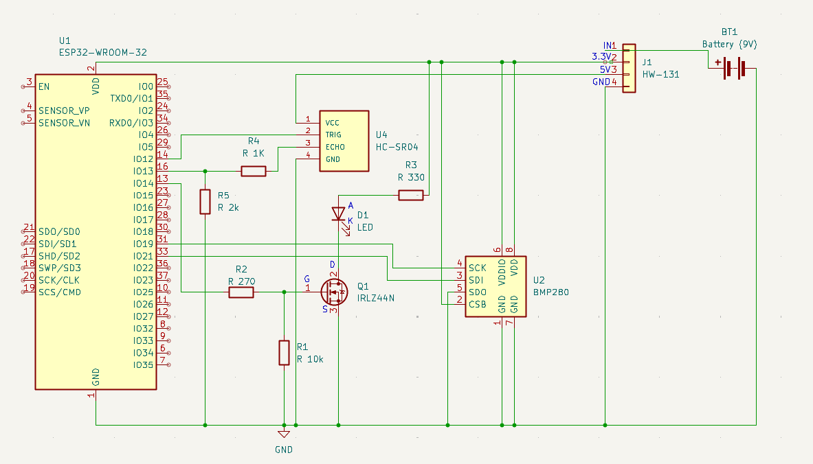

# ESP32 Ultrasonic, Barometric & MOSFET LED Controller

An embedded systems prototype built on the **ESP32** platform that combines ultrasonic proximity sensing (**HC-SR04**), atmospheric temperature and pressure monitoring (**BMP280**), and distance-proportional low-side MOSFET LED dimming (**IRLZ44N**).

## Key Engineering Features
* **Logic-Level Protection:** Steps down the 5V HC-SR04 `ECHO` pulse to ~3.33V via a `1kΩ / 2kΩ` voltage divider to protect ESP32 3.3V GPIO pins.
* **Low-Side MOSFET Switching:** Uses an `IRLZ44N` logic-level N-Channel MOSFET driven through a `270Ω` gate current-limiting resistor and a `10kΩ` pull-down resistor to prevent floating-gate triggers during boot.
* **Non-Blocking Firmware Architecture:** Separates fast 30 ms ultrasonic/PWM control loops from 500 ms `millis()`-timed I2C telemetry reads to ensure flicker-free LED dimming.
* **Software Noise Filtering:** Applies an exponential moving average (EMA) filter to ultrasonic distance readings to eliminate jitter.

## Pinout Configuration

| Component | Pin / Signal | ESP32 GPIO | Notes |
| :--- | :--- | :--- | :--- |
| **HC-SR04** | `TRIG` | `GPIO 12` | 5V VCC supply |
| **HC-SR04** | `ECHO` | `GPIO 13` | Connected via `1kΩ / 2kΩ` voltage divider |
| **BMP280** | `SDA` | `GPIO 21` | 3.3V VCC supply, I2C Address `0x76` |
| **BMP280** | `SCL` | `GPIO 19` | I2C Clock |
| **IRLZ44N** | `Gate` | `GPIO 14` | `270Ω` series + `10kΩ` pull-down to GND |

## Hardware Schematic

## Breadboard Prototype

